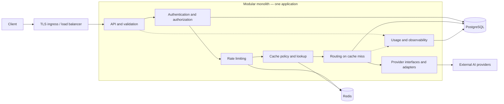

# Distributed AI Gateway

A production-oriented gateway providing a consistent API over multiple AI providers, with centralized authentication, routing, rate limiting, and optional caching.

## Current status

**Phases 1–3 are implemented: foundation, unified mock chat API, and an optional OpenAI Chat Completions adapter.** The application uses Java 21, Spring Boot 3.5.16, and Maven. It includes capability package documentation, profile/environment configuration, minimal Actuator health, framework error conventions, JUnit 5 unit and HTTP integration tests, a Maven wrapper, CI, and optional application-only Docker execution.

`POST /v1/chat/completions`, Bean Validation, provider selection, sanitized Problem Details, and mock enable/disable configuration are implemented. The OpenAI adapter uses Spring WebClient with configurable model aliases, deadlines, sanitized errors, and no automatic retries. Model discovery, authentication, tenant management, policy routing, rate limiting, caching, persistence, and durable usage accounting remain planned. The default mock path requires no external services or credentials; OpenAI calls require an operator-supplied API key.

## 1. Overview and problem statement

Direct integrations with AI vendors duplicate authentication, request translation, error handling, quotas, and availability logic across applications. Vendor-specific formats also make switching models or providers expensive.

The gateway will expose a stable client contract and isolate vendor behavior behind provider interfaces. It will apply tenant policies, select eligible providers, normalize results, and expose operational signals. Start as a modular monolith, with shared state and boundaries designed to support future horizontal scaling.

## 2. Goals and non-goals

### Goals — planned

- Provide versioned synchronous text chat and model-discovery APIs.
- Authenticate gateway clients and authorize tenant-scoped model access.
- Support interchangeable provider adapters and configurable routing.
- Enforce distributed request limits and optionally cache eligible responses.
- Bound failures, resource consumption, and provider attempts.
- Support stateless replicas and observable, testable operations.

### Initial non-goals

- Model training, fine-tuning, or hosting.
- Full compatibility with every vendor API or OpenAI API extension.
- Streaming, embeddings, image/audio generation, tool execution, and asynchronous jobs.
- Autonomous agents, prompt orchestration, and an administration dashboard.
- Early microservices, multi-region active-active deployment, and automatic cost optimization.
- Exactly-once execution or guaranteed prevention of duplicate provider billing after ambiguous failures.

## 3. Core functional requirements — planned

| Capability | Required behavior |
| --- | --- |
| Authentication | Validate gateway API keys, identify tenants, support rotation/revocation, and enforce model access. |
| Validation | Check message roles, body size, generation parameters, and model capabilities before provider calls. |
| Provider integration | Translate requests/responses through provider-neutral interfaces; keep credentials server-side. |
| Routing | Map logical models to configured provider models and select eligible providers using policy and health. |
| Rate limiting | Enforce atomic tenant/key request limits in Redis; return `429` with `Retry-After`. |
| Caching | Use policy-controlled TTLs, tenant isolation, and keys covering all output-affecting inputs. |
| Resilience | Apply connection/response/overall deadlines, concurrency bounds, circuit breakers, and constrained retries/fallback. |
| Usage tracking | Record tenant, provider/model, outcome, latency, reported tokens, and cache status; omit prompts by default. |
| Operations | Provide restricted health signals, structured logs, metrics, and request correlation. |

Start with one adapter. Add a second to prove API and routing logic remain independent of vendor protocols. Token and cost budgets are future extensions to request-rate enforcement.

## 4. Non-functional requirements — planned

- **Security:** TLS, hashed gateway keys, externally supplied secrets, least privilege, tenant isolation, and credential/prompt redaction. Provider destinations are operator-controlled, not arbitrary client URLs.
- **Reliability:** Bound execution time and resource use; expose sanitized, consistent errors. Never retry indefinitely.
- **Scalability:** Keep replicas stateless. PostgreSQL owns durable state; Redis owns distributed counters and expiring cache entries. Local counters cannot enforce global quotas.
- **Performance:** Measure gateway-added latency separately from provider latency. Establish numeric throughput, latency, concurrency, and availability targets after a measured baseline; no SLO is claimed yet.
- **Maintainability:** Follow SOLID principles, constructor injection, clear module ownership, interfaces, and typed exception handling.
- **Observability:** Correlate logs/traces with request IDs. Avoid high-cardinality request/tenant labels in general metrics.
- **Privacy:** Define retention, deletion, and residency policies before production. Cached prompts and responses are sensitive data.
- **Operability:** Validate configuration, use compatible schema migrations, drain requests during shutdown, and document dependency failures.

## 5. Proposed technology stack

| Technology | Intended role | Current state |
| --- | --- | --- |
| Java 21 | Runtime and language baseline | Configured with compiler release 21 |
| Spring Boot 3.5.16 | HTTP foundation, configuration, injection, health | Implemented; mock and optional OpenAI chat available |
| Maven 3.9.11 | Build and dependency management | Wrapper included |
| PostgreSQL | Tenants, hashed API keys, model mappings, policies, usage metadata | Not integrated |
| Redis | Atomic rate counters and expiring response cache | Not integrated |
| Docker | Optional application container | Dockerfile and application-only Compose included |
| JUnit 5 and Mockito | Unit and module tests | Available through Boot test starter; unit and HTTP integration tests included |

Direct dependencies are the web, WebFlux (WebClient/Reactor Netty), validation, Actuator, and test starters plus the existing Prometheus registry. The server remains Spring MVC. Only health is exposed over HTTP. Persistence/migration tools and circuit-breaker tooling remain to be selected. **Ask before introducing any new dependency**, as required by `AGENTS.md`.

## 6. High-level system architecture



### Proposed module boundaries

- **API:** HTTP contracts, validation, and error mapping; no vendor logic.
- **Identity:** Key verification, tenant context, and authorization.
- **Rate limiting:** Limiter interface and Redis implementation, separate from routing and caching.
- **Caching:** Eligibility policy, key construction, reads, and writes behind a cache interface.
- **Routing:** Logical-model resolution and provider selection. An application orchestrator coordinates the pipeline.
- **Providers:** A provider-neutral interface, such as `AiProvider`, for capabilities and completions. Each adapter owns vendor transport, payloads, credentials, and error translation.
- **Persistence:** Repository interfaces and storage implementations.
- **Observability:** Sanitized usage events, correlation, metrics, and traces.

The implemented root is `com.sunny.gateway`, with documented capability packages: `gateway`, `provider`, `routing`, `authentication`, `ratelimit`, `tenant`, `usage`, `config`, and `common`. The gateway API/orchestrator, provider interface, mock/OpenAI adapters, and simple provider selector are implemented; other capability implementations remain planned. These packages are code boundaries within one deployable application. Domain/application code depends on interfaces implemented by infrastructure adapters. Modules communicate through public contracts rather than accessing implementation details.

### Request flow and failure policy

1. Assign a request ID and validate the request envelope.
2. Authenticate and authorize the tenant and logical model.
3. Consume request-rate allowance before cache lookup so hits cannot bypass limits.
4. Resolve routing configuration and cache eligibility; return eligible cache hits.
5. On a miss, select a provider and execute within concurrency and deadline limits.
6. Normalize the result, optionally cache successful responses, and record sanitized usage for hits and misses.

Cache keys include tenant identity, logical model, routing/configuration revision, normalized messages, and every output-affecting option. Use opaque digests rather than plaintext prompts as Redis keys. Cache sensitive or nondeterministic requests only under explicit policy; caching is disabled by default.

Retries and fallback share one deadline and attempt budget. An upstream timeout may follow billable execution, so automatic replay after uncertain delivery is disabled by default. Provider idempotency guarantees and explicit policy may permit scoped retries. Fallback uses only configured equivalents authorized for the tenant.

PostgreSQL is the durable source of truth. Configuration caches need bounded staleness and a defined revocation strategy. Redis failure returns `503` for requests requiring rate enforcement; cache-only failure bypasses caching. Readiness reflects dependencies necessary to serve safely; provider health informs routing rather than process liveness.

Horizontal scaling adds replicas behind the load balancer. Verify distributed quotas, connection pools, configuration freshness, and provider concurrency across replicas before claiming scale readiness. Service extraction should follow measured needs, not precede them.

## 7. Core API contracts

### Implemented: `POST /v1/chat/completions`

The Phase 2 API is a small synchronous text-chat contract, not full OpenAI compatibility. It has no gateway authentication and returns one assistant choice. `mock-chat` requires no credentials; `openai-chat` is available when OpenAI is enabled and configured. `GET /v1/models`, streaming, request correlation headers, additional providers, and the broader future contracts remain planned.

```sh
curl --fail-with-body http://127.0.0.1:8080/v1/chat/completions \
  -H 'Content-Type: application/json' \
  -d '{"model":"mock-chat","messages":[{"role":"system","content":"Be brief"},{"role":"user","content":"Hello world"}],"temperature":0.2,"max_tokens":256}'
```

Expected HTTP `200` (ID is stable for identical deserialized requests):

```json
{
  "id": "mock-<deterministic UUID>",
  "model": "mock-chat",
  "choices": [{
    "index": 0,
    "message": {"role": "assistant", "content": "Mock response: Hello world"},
    "finish_reason": "stop"
  }],
  "usage": {"prompt_tokens": 4, "completion_tokens": 4, "total_tokens": 8}
}
```

Required fields: a nonblank `model` (maximum 128 characters) and 1–100 messages. Every message must be non-null, use `system`, `user`, or `assistant`, and contain nonblank text up to 32,768 characters. Optional `temperature` is 0–2; the deterministic mock accepts it without changing output. Optional `max_tokens` is 1–4096 (default 4096). `stream` must be omitted, null, or false. Unknown JSON fields are rejected. No HTTP body-byte limit is implemented yet.

The mock prefixes the last user message with `Mock response: `; without a user message it returns `Mock response: No user message.`. It truncates by whitespace-separated words to the output limit and reports `finish_reason: length` when truncated, otherwise `stop`. Usage counts whitespace-separated words across all input messages and the output. These counts are **simulated tokens**, not vendor tokenizer measurements or billable usage. IDs derive from the parsed request; no clock, network, or credentials are involved.

### Implemented error contract

All errors use Spring MVC Problem Details (`application/problem+json`). Domain and validation errors add a stable `code`; framework errors retain standard Problem Details fields. Error responses never include submitted message text, provider exception messages, or stack traces.

```json
{
  "type": "about:blank",
  "title": "Bad Request",
  "status": 400,
  "detail": "The requested model is not supported.",
  "instance": "/v1/chat/completions",
  "code": "unsupported_model"
}
```

| Status | Code | Meaning |
| --- | --- | --- |
| `400` | `invalid_request` | Invalid messages/options, malformed JSON, or unknown fields |
| `400` | `unsupported_model` | No enabled provider supports the requested alias (including OpenAI aliases when disabled) |
| `503` | `provider_unavailable` | Mock disabled, or OpenAI returns 429/503 |
| `503` | `provider_credentials_missing` | Enabled OpenAI selected without `OPENAI_API_KEY` |
| `503` | `provider_authentication_error` | OpenAI returns 401/403; this is provider authentication, not client authentication |
| `504` | `provider_timeout` | Connection, response-read, or overall deadline exceeded |
| `502` | `provider_error` | OpenAI 400/500/other error, connection failure, malformed/empty/oversized response, or adapter failure |
| `500` | `internal_error` | Unexpected failure, with sanitized detail |

The mock does not expose a client-controlled failure trigger. Tests substitute a failing provider to verify error mapping through the controller/service/interface path.

### Implemented class boundaries

`ChatCompletionController` validates HTTP requests and delegates to `GatewayService`. The service asks `routing.ProviderSelector` for the first registered provider supporting the model, then calls `provider.LLMProvider`. `MockLLMProvider` implements that boundary and is conditionally registered. Request/message/response records define the client contract; `GatewayExceptionHandler` maps gateway, adapter, validation, and parsing failures. `provider.openai` owns configuration, WebClient transport, wire DTOs, and mapping. No routing policy engine or speculative storage abstractions are introduced.

### Operational endpoints

Implemented: `GET /actuator/health` returns `200` with `{"status":"UP"}` for the current application. Only health is exposed; components and details are hidden. The Actuator discovery endpoint may list health. Default binding is loopback. Separate readiness/liveness probes and infrastructure access restrictions are planned.

Spring MVC Problem Details is enabled for framework errors, such as an unknown resource returning `application/problem+json` with `status`, `title`, `detail`, `type`, and `instance`. Gateway errors now use the same Problem Details convention with a `code` extension. Default servlet error responses suppress exception names, messages, binding errors, and stack traces. The global advice sanitizes domain and unexpected errors while preserving framework HTTP status handling.

## 8. Eight-phase implementation roadmap

Phases 1–3 are implemented, with Phase 3 now scoped to the requested OpenAI integration. The original identity/persistence Phase 3 proposal is deferred. Phases 4–8, identity/persistence, and model discovery remain **not started**. Implement one capability at a time using failing tests, implementation, and refactoring. Obtain dependency approval before adding libraries.

| Phase | Scope | Exit criteria |
| --- | --- | --- |
| 1. Foundation — implemented | Java 21 Spring Boot bootstrap, capability packages, configuration, health, tests, CI, optional Docker | Verify with `./mvnw clean verify`, local startup, and health check; Docker and hosted CI need their own execution |
| 2. Unified API/mock provider — implemented | Completion contract, validation, errors, provider boundary, deterministic mock, enable/disable switch | Unit/HTTP contract tests and local curl pass; model discovery and real adapters remain deferred |
| 3. OpenAI integration — implemented | WebClient adapter, model aliases, environment credentials, timeouts, safe errors, no retries | Mapping/configuration tests and local HTTP-stub tests pass; live paid calls are not automated |
| 4. Distributed rate limiting | Add atomic Redis request limits and dependency failure policy | Concurrency/window boundaries, `429` headers, outage behavior, and two-replica enforcement verified |
| 5. Routing/resilience | Add second provider, model policies, health selection, deadlines, breakers, bounded retries/fallback | Provider substitution requires no API changes; timeout, ambiguity, fallback, and concurrency tests pass |
| 6. Response caching | Add opt-in policy, TTLs, isolation, and configuration-sensitive keys | Hit/miss, expiry, option sensitivity, invalidation, isolation, and cache outage tests pass |
| 7. Production hardening | Add metrics/traces, usage metadata, secret redaction, resource limits, graceful shutdown | Failures diagnosable; sensitive-data checks pass; load baseline and proposed SLOs reviewed |
| 8. Deployment/scale validation | Add Docker/local services, CI, runbooks, migrations/rollback, multi-replica exercises | Staging rollout, scale, dependency recovery, backup restoration, and rollback verified |

The gateway stays restricted to trusted local development until a future identity phase supplies authentication. The current OpenAI integration does not provide authentication; do not expose it as an unauthenticated public provider proxy.

## 9. Local setup, build, run, and test

Required: JDK 21, Git, and network access to Maven Central on the first wrapper/build invocation. A separate Maven installation is unnecessary. Docker with Compose is optional. No database or Redis is needed. Provider credentials are required only for explicitly enabled real OpenAI calls.

On macOS, select JDK 21 explicitly when several JDKs are installed:

```sh
export JAVA_HOME="$(/usr/libexec/java_home -v 21)"
export PATH="$JAVA_HOME/bin:$PATH"
java -version
./mvnw --version
./mvnw clean verify
./mvnw spring-boot:run
```

On other platforms, set `JAVA_HOME` to your JDK 21 installation. Windows users can use `mvnw.cmd` instead of `./mvnw`.

On Apple Silicon macOS with an ARM JDK (`os.arch=aarch64`), Maven automatically activates `macos-arm64-dns` to include Netty's native macOS DNS resolver. Its version follows Spring Boot's managed Netty version. This resolves the native-library loading error reported by WebClient on ARM Macs. Linux and Intel builds do not activate this profile.

In another terminal:

```sh
curl --fail http://127.0.0.1:8080/actuator/health
```

Expected response: `{"status":"UP"}`. Stop the app with Ctrl+C. To run the packaged application after verification:

```sh
java -jar target/Distriubuted_AI_Gateway-1.0-SNAPSHOT.jar
```

### Configuration

`application.yml` provides a default `local` profile, a `test` profile with an ephemeral port, and a `prod` profile with ECS JSON console logs. Shared defaults hide health details and servlet error diagnostics and enable graceful shutdown.

| Variable | Default | Purpose |
| --- | --- | --- |
| `SPRING_PROFILES_ACTIVE` | `local` (default profile) | Select environment profile |
| `SERVER_ADDRESS` | `127.0.0.1` | Bind address; containers set `0.0.0.0` |
| `SERVER_PORT` | `8080` | Application port |
| `LOG_LEVEL` | `INFO` | Root log level |
| `MOCK_PROVIDER_ENABLED` | `true` | Enable mock adapter; false makes `mock-chat` return 503 |
| `OPENAI_ENABLED` | `false` | Register the real provider and its WebClient |
| `OPENAI_API_KEY` | empty | Server-side Bearer credential, read from the environment |
| `OPENAI_CHAT_MODEL` | `gpt-4o-mini` | Vendor model behind `openai-chat` |
| `OPENAI_CONNECT_TIMEOUT` | `5s` | TCP connection timeout |
| `OPENAI_RESPONSE_TIMEOUT` | `30s` | Maximum interval between response network reads |
| `OPENAI_REQUEST_TIMEOUT` | `40s` | Overall adapter deadline, including connection and decoding |

Spring Boot does not load `.env` automatically. The example contains only non-secret settings. For a trusted local file in a POSIX shell:

```sh
cp .env.example .env
set -a
. ./.env
set +a
./mvnw spring-boot:run
```

Production-profile example:

```sh
SPRING_PROFILES_ACTIVE=prod SERVER_PORT=9090 ./mvnw spring-boot:run
```

The production profile alone does not supply TLS or authentication. Keep deployment access controlled until those features exist. Never commit credentials or hardcode production defaults.

### Running the real OpenAI provider

Export `OPENAI_API_KEY` through your trusted local environment or edit your ignored `.env` copy (leave the committed example empty). Spring does not load `.env` automatically. With the key already exported:

```sh
OPENAI_ENABLED=true ./mvnw spring-boot:run
```

Then call the gateway; the key is never sent by the client to this endpoint:

```sh
curl --fail-with-body http://127.0.0.1:8080/v1/chat/completions \
  -H 'Content-Type: application/json' \
  -d '{"model":"openai-chat","messages":[{"role":"system","content":"Be concise."},{"role":"user","content":"Explain consistent hashing in one sentence."}],"temperature":0.2,"max_tokens":128}'
```

This explicit real-provider example makes a billable OpenAI request when valid credentials and model access are available. It was not executed against OpenAI during automated verification. The mock example continues to work whether OpenAI is enabled or disabled.

Supported aliases are `mock-chat` and, when enabled, `openai-chat → gpt-4o-mini`. Override the latter with `OPENAI_CHAT_MODEL`. Add aliases through operator-controlled Spring configuration:

```yaml
gateway:
  openai:
    models:
      team-chat: gpt-4o-mini
```

Use aliases as the client `model`; successful normalized responses report that alias, even if OpenAI reports a versioned model name. Alias/model values must be nonblank and `mock-chat` is reserved. Timeouts must be between 1ms and one day. Invalid model/timeout configuration fails startup. Enabling without credentials still allows startup, health, and mock requests; selecting OpenAI then returns `503 provider_credentials_missing` without a network call.

The adapter sends exactly one non-streaming completion to `https://api.openai.com/v1/chat/completions`. Roles/content are copied in order. Optional temperature is sent only when supplied; gateway `max_tokens` becomes OpenAI `max_completion_tokens`. Omitting it leaves the vendor default. Mapping a model does not guarantee it supports temperature, these roles, or text-only chat; use compatible Chat Completions models. See the [OpenAI Chat Completions reference](https://developers.openai.com/api/reference/resources/chat/subresources/completions/methods/create) and [GPT-4o mini documentation](https://developers.openai.com/api/docs/models/gpt-4o-mini).

OpenAI response IDs, assistant text, and integer token usage are normalized without estimates. Finish reasons are `stop`, `length`, `content_filter`, or `unknown`. Empty bodies, missing ID/model/text/usage, inconsistent usage, and unsupported response structures return `502`. Unknown vendor metadata is ignored. Responses are limited to 1 MiB in memory. Tool calls, multimodal output, refusal metadata, and streaming are not supported. A refusal without text returns `502` rather than fabricating a completion.

Provider error bodies are discarded; their contents, exception causes, and credentials are not returned or logged by the adapter. Redirect following and Reactor Netty's transport replay are explicitly disabled, and no application retries or fallbacks are added. A timeout cannot establish whether OpenAI already generated/billed a response, so manually replaying a POST may incur another charge. The synchronous MVC contract waits on WebClient until the configured deadline.

Compose forwards the same OpenAI environment settings, including the key at runtime. No secret enters the image or committed configuration. Keep access local while gateway authentication remains deferred.

### Tests

```sh
./mvnw test          # Surefire: unit/configuration tests ending in Test
./mvnw clean verify  # Also runs Failsafe HTTP integration tests ending in IT
```

Tests require no external services or credentials and make no live or paid OpenAI calls. The test profile disables OpenAI regardless of ambient `OPENAI_ENABLED`; adapter tests use only a loopback JDK HTTP server and a fake credential. HTTP integration tests start the real application on an ephemeral port under the `test` profile. Reports are written to ignored `target/surefire-reports` and `target/failsafe-reports`.

### Optional Docker execution

```sh
docker compose up --build -d
curl --fail http://127.0.0.1:8080/actuator/health
docker compose down
```

Compose runs only the gateway and binds the published port to host loopback. Its `.env` support comes from Compose, independently of Spring Boot. The multi-stage Docker build runs `clean verify`, then copies the executable JAR into a Java 21 runtime image running as a numeric non-root user. Docker execution must be verified separately from a Maven build.

## 10. Testing and deployment strategy

### Testing

Use incremental test-driven development and run tests after application changes. Use JUnit 5 and Mockito for unit/module tests of authorization, routing, validation, cache policy, and exception mapping.

- **Contract tests:** Validate schemas, statuses, model visibility, request bounds, and sanitized errors.
- **Adapter tests:** Use deterministic HTTP stubs for success, malformed payloads, throttling, timeouts, and uncertain delivery. Live tests are opt-in to control cost and nondeterminism.
- **Integration tests:** Exercise real PostgreSQL and Redis for migrations, isolation, atomic limits, TTLs, and dependency failures; select tooling after approval.
- **Load/multi-replica tests:** Measure gateway overhead and verify shared quotas, concurrency bounds, pools, and configuration freshness with controlled upstreams.
- **Security/recovery tests:** Cover rotation/revocation, secret redaction, oversized requests, authorization, shutdown, and dependency recovery.

Implemented tests check safe configuration defaults, production logging and external overrides, real-HTTP health, management endpoint exposure, and framework Problem Details. Phase 2 tests cover deterministic completions, validation, unknown models, truncation, safe failure mapping, and disabled-provider startup. Phase 3 tests cover wire mapping, model/timeout configuration, Bearer headers, local HTTP success, 400/401/403/429/500/503 errors, malformed/empty responses, missing credentials, response/overall timeouts, refused connections, and connection resets without retry. Additional capability, dependency, load, and security tests remain planned.

### Deployment

The implemented foundation builds one executable modular-monolith JAR and provides an optional application container. PostgreSQL and Redis are not introduced in Phase 1; add them only when required by a feature. Terminate TLS at ingress, inject secrets externally, run without root privileges, and restrict operational endpoints.

GitHub Actions CI is configured to use Temurin JDK 21 and run `./mvnw --batch-mode --no-transfer-progress clean verify` on pushes and pull requests, with read-only repository permissions. Hosted CI execution has not been observed locally. Dependency/image scans, image publication, staging promotion, and deployment automation remain planned.

Use backward-compatible migrations with separately controlled execution, readiness-gated rollout, and graceful draining. Keep the previous image for application rollback. Database recovery needs a reviewed plan; do not assume migrations are reversible. Verify backups/restoration and Redis-loss behavior. A CI workflow, Dockerfile, and local Compose configuration now exist. Production deployment manifests, migrations, runbooks, and environments remain planned.

## 11. Future improvements

- Streaming with cancellation and backpressure.
- Embeddings, multimodal support, and asynchronous jobs.
- Provider-aware idempotency where vendor guarantees allow it.
- Token/cost budgets, usage reconciliation, and pricing-aware routing.
- Semantic caching under explicit privacy/correctness policy.
- Administration interfaces and enterprise identity.
- Regional routing and disaster recovery guided by residency requirements.
- Service extraction when measured scaling, availability, or ownership needs justify it.

## Open questions

- Which providers/models anchor the first two adapters?
- Should compatibility target a documented OpenAI subset or an independent contract?
- What traffic, latency, availability, cost, and payload-size targets should define limits and SLOs?
- How are tenants onboarded and keys issued, and how quickly must revocation propagate?
- Which requests may be cached, with what TTL, retention, and residency requirements?
- Which failures permit retries/fallback, and is potential duplicate billing ever acceptable?
- What hosting environment, secret manager, and operations access model are intended?

Follow `AGENTS.md`: explain architecture decisions, implement one feature at a time, run tests after code changes, ask before new dependencies, and do not commit or push without permission.
