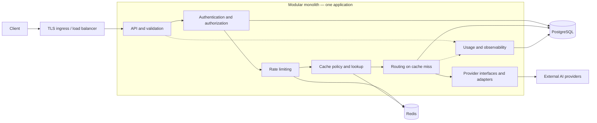

# Distributed AI Gateway

A production-oriented gateway providing a consistent API over multiple AI providers, with centralized authentication, routing, rate limiting, and optional caching.

## Current status

**Scaffold only; all gateway capabilities in this document are planned.** The repository contains a minimal Maven project and an IDE-generated sample `Main` class. There are no Spring Boot dependencies, gateway endpoints, provider integrations, tests, database integration, Redis integration, or deployment files.

The project baseline is **JDK 26 and Spring Boot**. The current `pom.xml` already targets Java 26. Replacing the sample with a Spring Boot application and verifying the selected framework and build tooling against JDK 26 are phase 1 work. This README does not establish that the application builds or runs successfully.

## 1. Overview and problem statement

Direct integrations with AI vendors duplicate authentication, request translation, error handling, quotas, and availability logic across applications. Vendor-specific formats also make switching models or providers expensive.

The gateway will expose a stable client contract and isolate vendor behavior behind provider interfaces. It will apply tenant policies, select eligible providers, normalize results, and expose operational signals. Start as a modular monolith, with shared state and boundaries designed to support future horizontal scaling.

## 2. Goals and non-goals

### Goals — planned

- Provide versioned synchronous text chat and model-discovery APIs.
- Authenticate gateway clients and authorize tenant-scoped model access.
- Support interchangeable provider adapters and configurable routing.
- Enforce distributed request limits and optionally cache eligible responses.
- Bound failures, resource consumption, and provider attempts.
- Support stateless replicas and observable, testable operations.

### Initial non-goals

- Model training, fine-tuning, or hosting.
- Full compatibility with every vendor API or OpenAI API extension.
- Streaming, embeddings, image/audio generation, tool execution, and asynchronous jobs.
- Autonomous agents, prompt orchestration, and an administration dashboard.
- Early microservices, multi-region active-active deployment, and automatic cost optimization.
- Exactly-once execution or guaranteed prevention of duplicate provider billing after ambiguous failures.

## 3. Core functional requirements — planned

| Capability | Required behavior |
| --- | --- |
| Authentication | Validate gateway API keys, identify tenants, support rotation/revocation, and enforce model access. |
| Validation | Check message roles, body size, generation parameters, and model capabilities before provider calls. |
| Provider integration | Translate requests/responses through provider-neutral interfaces; keep credentials server-side. |
| Routing | Map logical models to configured provider models and select eligible providers using policy and health. |
| Rate limiting | Enforce atomic tenant/key request limits in Redis; return `429` with `Retry-After`. |
| Caching | Use policy-controlled TTLs, tenant isolation, and keys covering all output-affecting inputs. |
| Resilience | Apply connection/response/overall deadlines, concurrency bounds, circuit breakers, and constrained retries/fallback. |
| Usage tracking | Record tenant, provider/model, outcome, latency, reported tokens, and cache status; omit prompts by default. |
| Operations | Provide restricted health signals, structured logs, metrics, and request correlation. |

Start with one adapter. Add a second to prove API and routing logic remain independent of vendor protocols. Token and cost budgets are future extensions to request-rate enforcement.

## 4. Non-functional requirements — planned

- **Security:** TLS, hashed gateway keys, externally supplied secrets, least privilege, tenant isolation, and credential/prompt redaction. Provider destinations are operator-controlled, not arbitrary client URLs.
- **Reliability:** Bound execution time and resource use; expose sanitized, consistent errors. Never retry indefinitely.
- **Scalability:** Keep replicas stateless. PostgreSQL owns durable state; Redis owns distributed counters and expiring cache entries. Local counters cannot enforce global quotas.
- **Performance:** Measure gateway-added latency separately from provider latency. Establish numeric throughput, latency, concurrency, and availability targets after a measured baseline; no SLO is claimed yet.
- **Maintainability:** Follow SOLID principles, constructor injection, clear module ownership, interfaces, and typed exception handling.
- **Observability:** Correlate logs/traces with request IDs. Avoid high-cardinality request/tenant labels in general metrics.
- **Privacy:** Define retention, deletion, and residency policies before production. Cached prompts and responses are sensitive data.
- **Operability:** Validate configuration, use compatible schema migrations, drain requests during shutdown, and document dependency failures.

## 5. Proposed technology stack

| Technology | Intended role | Current state |
| --- | --- | --- |
| JDK 26 / Java 26 | Runtime and language baseline | Maven source and target already configured for Java 26; build verification pending |
| Spring Boot | HTTP API, configuration, injection, operational endpoints | Not configured |
| Maven | Build and dependency management | Minimal POM exists; no wrapper |
| PostgreSQL | Tenants, hashed API keys, model mappings, policies, usage metadata | Not integrated |
| Redis | Atomic rate counters and expiring response cache | Not integrated |
| Docker | Application image and local dependency services | No Docker configuration |
| JUnit 5 and Mockito | Unit and module tests | Not configured |

Framework versions, HTTP client, persistence and migration tools, resilience library, and integration-test tooling remain to be selected. **Ask before introducing any new dependency**, as required by `AGENTS.md`.

## 6. High-level system architecture



### Proposed module boundaries

- **API:** HTTP contracts, validation, and error mapping; no vendor logic.
- **Identity:** Key verification, tenant context, and authorization.
- **Rate limiting:** Limiter interface and Redis implementation, separate from routing and caching.
- **Caching:** Eligibility policy, key construction, reads, and writes behind a cache interface.
- **Routing:** Logical-model resolution and provider selection. An application orchestrator coordinates the pipeline.
- **Providers:** A provider-neutral interface, such as `AiProvider`, for capabilities and completions. Each adapter owns vendor transport, payloads, credentials, and error translation.
- **Persistence:** Repository interfaces and storage implementations.
- **Observability:** Sanitized usage events, correlation, metrics, and traces.

These are proposed code boundaries, not existing packages or independently deployed services. Domain/application code depends on interfaces implemented by infrastructure adapters. Modules communicate through public contracts rather than accessing implementation details.

### Request flow and failure policy

1. Assign a request ID and validate the request envelope.
2. Authenticate and authorize the tenant and logical model.
3. Consume request-rate allowance before cache lookup so hits cannot bypass limits.
4. Resolve routing configuration and cache eligibility; return eligible cache hits.
5. On a miss, select a provider and execute within concurrency and deadline limits.
6. Normalize the result, optionally cache successful responses, and record sanitized usage for hits and misses.

Cache keys include tenant identity, logical model, routing/configuration revision, normalized messages, and every output-affecting option. Use opaque digests rather than plaintext prompts as Redis keys. Cache sensitive or nondeterministic requests only under explicit policy; caching is disabled by default.

Retries and fallback share one deadline and attempt budget. An upstream timeout may follow billable execution, so automatic replay after uncertain delivery is disabled by default. Provider idempotency guarantees and explicit policy may permit scoped retries. Fallback uses only configured equivalents authorized for the tenant.

PostgreSQL is the durable source of truth. Configuration caches need bounded staleness and a defined revocation strategy. Redis failure returns `503` for requests requiring rate enforcement; cache-only failure bypasses caching. Readiness reflects dependencies necessary to serve safely; provider health informs routing rather than process liveness.

Horizontal scaling adds replicas behind the load balancer. Verify distributed quotas, connection pools, configuration freshness, and provider concurrency across replicas before claiming scale readiness. Service extraction should follow measured needs, not precede them.

## 7. Core API contracts — proposed, not available

The initial JSON contract is inspired by familiar chat APIs but does not promise drop-in compatibility. Finalize contracts with tests before implementation.

### Common conventions

- Client endpoints use `/v1` and `Authorization: Bearer <gateway-api-key>`; this is not a vendor key.
- Responses include `X-Request-ID`; errors include the same ID in their body.
- Models are configured logical aliases. Clients cannot supply vendor credentials or provider URLs.
- No initial idempotency guarantee: repeating a POST may cause additional billable work.

### `POST /v1/chat/completions`

Illustrative request:

```json
{
  "model": "chat-default",
  "messages": [{ "role": "user", "content": "Explain consistent hashing briefly." }],
  "temperature": 0.2,
  "max_tokens": 256,
  "stream": false
}
```

`model` and a nonempty `messages` array are required. Initial roles are `system`, `user`, and `assistant`, with text-only content. Optional `temperature` must satisfy the model's advertised range; optional `max_tokens` is a positive integer within configured limits. Only omitted or `false` streaming is supported. Unknown fields, unsupported options, and invalid parameters return `400`; oversized bodies return `413`.

Illustrative `200` response:

```json
{
  "id": "gw_example",
  "object": "chat.completion",
  "created": 1791504000,
  "model": "chat-default",
  "choices": [{
    "index": 0,
    "message": { "role": "assistant", "content": "Consistent hashing maps keys and nodes onto a ring..." },
    "finish_reason": "stop"
  }],
  "usage": { "prompt_tokens": 12, "completion_tokens": 18, "total_tokens": 30 },
  "gateway": { "request_id": "req_example", "cached": false }
}
```

Initially return one completion. Normalize finish reasons to `stop`, `length`, `content_filter`, or `unknown`. Unreported token counts are `null`, not invented estimates. Cache hits expose original completion usage with `cached: true`; internal accounting records that no new provider invocation occurred.

### `GET /v1/models`

Return only models authorized for the tenant, including capabilities and validation limits. These names and limits are illustrative, not existing configuration.

```json
{
  "object": "list",
  "data": [{
    "id": "chat-default",
    "capabilities": ["text_chat"],
    "limits": { "max_output_tokens": 4096, "temperature_min": 0, "temperature_max": 1 }
  }]
}
```

### Error contract

```json
{
  "error": {
    "code": "rate_limit_exceeded",
    "message": "Request limit exceeded.",
    "request_id": "req_example"
  }
}
```

| Status | Meaning |
| --- | --- |
| `400` | Invalid request, unknown logical model, or unsupported option |
| `401` | Missing, invalid, expired, or revoked key |
| `403` | Tenant lacks model permission |
| `413` | Body exceeds configured limit |
| `429` | Gateway rate allowance exhausted; `Retry-After` is in seconds |
| `502` | Upstream protocol failure or unusable response |
| `503` | No eligible provider, required dependency unavailable, or capacity exhausted |
| `504` | Overall execution deadline exceeded |
| `500` | Unexpected internal failure |

Sanitize all errors; do not forward vendor payloads or credentials. Upstream quota exhaustion maps to provider unavailability (`503`), distinct from gateway rate enforcement (`429`).

### Operational endpoints

Plan restricted `GET /actuator/health/liveness` and `GET /actuator/health/readiness`, returning `200` when healthy and `503` when unhealthy. These require future Spring Boot configuration and infrastructure access controls. Detailed health and metrics must not be publicly exposed.

## 8. Eight-phase implementation roadmap

Every phase is **not started**. Implement one capability at a time using failing tests, implementation, and refactoring. Obtain dependency approval before adding libraries.

| Phase | Scope | Exit criteria |
| --- | --- | --- |
| 1. Foundation | Verify JDK 26 tooling/framework compatibility; replace sample with Spring Boot; establish module/configuration and test setup | JDK 26 build, application startup, and smoke/configuration tests pass |
| 2. API/provider vertical slice | Implement completion/models contracts, validation, errors, and one provider adapter | Contract and controlled-upstream adapter tests pass; authorized development smoke call succeeds |
| 3. Identity/persistence | Add PostgreSQL schema/migrations, tenants, hashed keys, authorization, rotation/revocation | Unauthorized access rejected; tenant isolation and revocation verified; no plaintext keys stored |
| 4. Distributed rate limiting | Add atomic Redis request limits and dependency failure policy | Concurrency/window boundaries, `429` headers, outage behavior, and two-replica enforcement verified |
| 5. Routing/resilience | Add second provider, model policies, health selection, deadlines, breakers, bounded retries/fallback | Provider substitution requires no API changes; timeout, ambiguity, fallback, and concurrency tests pass |
| 6. Response caching | Add opt-in policy, TTLs, isolation, and configuration-sensitive keys | Hit/miss, expiry, option sensitivity, invalidation, isolation, and cache outage tests pass |
| 7. Production hardening | Add metrics/traces, usage metadata, secret redaction, resource limits, graceful shutdown | Failures diagnosable; sensitive-data checks pass; load baseline and proposed SLOs reviewed |
| 8. Deployment/scale validation | Add Docker/local services, CI, runbooks, migrations/rollback, multi-replica exercises | Staging rollout, scale, dependency recovery, backup restoration, and rollback verified |

Phase 2 stays restricted to local development until phase 3 authentication is complete. Intermediate work must not expose an unauthenticated public provider proxy.

## 9. Local development prerequisites

For the intended implementation:

- JDK 26 and `JAVA_HOME` pointing to its installation.
- Maven; supported version and wrapper will be established in phase 1.
- Docker with Compose support for planned PostgreSQL and Redis services.
- Git and an IDE supporting Java 26.
- Provider account/key only for explicitly enabled live tests; normal tests use stubs.

```sh
java -version
mvn -version
docker --version
docker compose version
```

**Current limitation:** the Maven scaffold targets Java 26, but the gateway is not implemented and build compatibility has not been verified. There is no working gateway startup command, Compose setup, migration configuration, or Spring Boot run configuration yet.

Planned configuration covers database/Redis connectivity, provider credentials, model mappings, quotas, deadlines, and cache policy. Document exact names when implemented. Inject secrets through environment variables or a secret manager; never commit credentials or hardcode production defaults.

Once phase 1 establishes the application and test setup on JDK 26, use `mvn verify` as the intended verification command. Document startup and service commands only once their supporting files exist.

## 10. Testing and deployment strategy — planned

### Testing

Use incremental test-driven development and run tests after application changes. Use JUnit 5 and Mockito for unit/module tests of authorization, routing, validation, cache policy, and exception mapping.

- **Contract tests:** Validate schemas, statuses, model visibility, request bounds, and sanitized errors.
- **Adapter tests:** Use deterministic HTTP stubs for success, malformed payloads, throttling, timeouts, and uncertain delivery. Live tests are opt-in to control cost and nondeterminism.
- **Integration tests:** Exercise real PostgreSQL and Redis for migrations, isolation, atomic limits, TTLs, and dependency failures; select tooling after approval.
- **Load/multi-replica tests:** Measure gateway overhead and verify shared quotas, concurrency bounds, pools, and configuration freshness with controlled upstreams.
- **Security/recovery tests:** Cover rotation/revocation, secret redaction, oversized requests, authorization, shutdown, and dependency recovery.

No tests are currently configured. A documentation-only change does not verify application behavior or build compatibility.

### Deployment

Ship one versioned modular-monolith artifact, initially in one container, with PostgreSQL and Redis as shared services. Terminate TLS at ingress, inject secrets externally, run without root privileges, and restrict operational endpoints.

Planned CI will build on JDK 26, run unit/integration/contract checks, scan dependencies/images, and produce an immutable image with a Java 26 runtime. Promote the same image through staging and production after smoke tests and migration review.

Use backward-compatible migrations with separately controlled execution, readiness-gated rollout, and graceful draining. Keep the previous image for application rollback. Database recovery needs a reviewed plan; do not assume migrations are reversible. Verify backups/restoration and Redis-loss behavior. No CI pipeline, image definition, deployment manifest, or production environment is represented in this repository yet.

## 11. Future improvements

- Streaming with cancellation and backpressure.
- Embeddings, multimodal support, and asynchronous jobs.
- Provider-aware idempotency where vendor guarantees allow it.
- Token/cost budgets, usage reconciliation, and pricing-aware routing.
- Semantic caching under explicit privacy/correctness policy.
- Administration interfaces and enterprise identity.
- Regional routing and disaster recovery guided by residency requirements.
- Service extraction when measured scaling, availability, or ownership needs justify it.

## Open questions

- Which providers/models anchor the first two adapters?
- Should compatibility target a documented OpenAI subset or an independent contract?
- What traffic, latency, availability, cost, and payload-size targets should define limits and SLOs?
- How are tenants onboarded and keys issued, and how quickly must revocation propagate?
- Which requests may be cached, with what TTL, retention, and residency requirements?
- Which failures permit retries/fallback, and is potential duplicate billing ever acceptable?
- What hosting environment, secret manager, and operations access model are intended?

Follow `AGENTS.md`: explain architecture decisions, implement one feature at a time, run tests after code changes, ask before new dependencies, and do not commit or push without permission.
