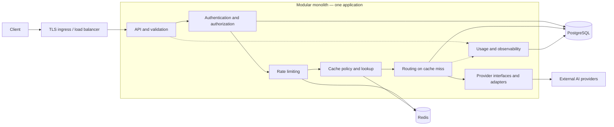

# Distributed AI Gateway

A production-oriented gateway providing a consistent API over multiple AI providers, with centralized authentication, routing, rate limiting, and optional caching.

## Current status

**Phases 1–6 are implemented: foundation, unified mock API, optional OpenAI adapter, PostgreSQL-backed tenant API-key authentication, Redis-backed distributed tenant rate limiting, and configurable tenant-aware model routing.** The application uses Java 21, Spring Boot 3.5.16, and Maven. It includes capability package documentation, profile/environment configuration, minimal Actuator health, framework error conventions, JUnit 5 unit and HTTP integration tests, a Maven wrapper, CI, and optional application-only Docker execution.

`POST /v1/chat/completions`, Bean Validation, provider selection, sanitized Problem Details, and mock enable/disable configuration are implemented. The OpenAI adapter uses Spring WebClient with configurable model aliases, deadlines, sanitized errors, and no automatic retries. Tenant/key persistence and stateless API-key authentication are implemented. Redis token buckets enforce per-tenant request limits across replicas. Priority and weighted random routing apply tenant model/provider allow-lists. Model discovery, caching, and usage billing remain planned. All chat requests now require an issued gateway key; PostgreSQL, Redis, and a separate gateway HMAC pepper are required under the default fail-closed policy. Mock chat needs no OpenAI credentials.

## 1. Overview and problem statement

Direct integrations with AI vendors duplicate authentication, request translation, error handling, quotas, and availability logic across applications. Vendor-specific formats also make switching models or providers expensive.

The gateway will expose a stable client contract and isolate vendor behavior behind provider interfaces. It will apply tenant policies, select eligible providers, normalize results, and expose operational signals. Start as a modular monolith, with shared state and boundaries designed to support future horizontal scaling.

## 2. Goals and non-goals

### Goals — planned

- Provide versioned synchronous text chat and model-discovery APIs.
- Authenticate gateway clients and authorize tenant-scoped model access.
- Support interchangeable provider adapters and configurable routing.
- Enforce distributed request limits and optionally cache eligible responses.
- Bound failures, resource consumption, and provider attempts.
- Support stateless replicas and observable, testable operations.

### Initial non-goals

- Model training, fine-tuning, or hosting.
- Full compatibility with every vendor API or OpenAI API extension.
- Streaming, embeddings, image/audio generation, tool execution, and asynchronous jobs.
- Autonomous agents, prompt orchestration, and an administration dashboard.
- Early microservices, multi-region active-active deployment, and automatic cost optimization.
- Exactly-once execution or guaranteed prevention of duplicate provider billing after ambiguous failures.

## 3. Core functional requirements — planned

| Capability | Required behavior |
| --- | --- |
| Authentication | Validate gateway API keys, identify tenants, support rotation/revocation, and enforce model access. |
| Validation | Check message roles, body size, generation parameters, and model capabilities before provider calls. |
| Provider integration | Translate requests/responses through provider-neutral interfaces; keep credentials server-side. |
| Routing | Map logical models to configured provider models and select eligible providers using policy and health. |
| Rate limiting | Enforce atomic tenant/key request limits in Redis; return `429` with `Retry-After`. |
| Caching | Use policy-controlled TTLs, tenant isolation, and keys covering all output-affecting inputs. |
| Resilience | Apply connection/response/overall deadlines, concurrency bounds, circuit breakers, and constrained retries/fallback. |
| Usage tracking | Record tenant, provider/model, outcome, latency, reported tokens, and cache status; omit prompts by default. |
| Operations | Provide restricted health signals, structured logs, metrics, and request correlation. |

Start with one adapter. Add a second to prove API and routing logic remain independent of vendor protocols. Token and cost budgets are future extensions to request-rate enforcement.

## 4. Non-functional requirements — planned

- **Security:** TLS, hashed gateway keys, externally supplied secrets, least privilege, tenant isolation, and credential/prompt redaction. Provider destinations are operator-controlled, not arbitrary client URLs.
- **Reliability:** Bound execution time and resource use; expose sanitized, consistent errors. Never retry indefinitely.
- **Scalability:** Keep replicas stateless. PostgreSQL owns durable state; Redis owns distributed counters and expiring cache entries. Local counters cannot enforce global quotas.
- **Performance:** Measure gateway-added latency separately from provider latency. Establish numeric throughput, latency, concurrency, and availability targets after a measured baseline; no SLO is claimed yet.
- **Maintainability:** Follow SOLID principles, constructor injection, clear module ownership, interfaces, and typed exception handling.
- **Observability:** Correlate logs/traces with request IDs. Avoid high-cardinality request/tenant labels in general metrics.
- **Privacy:** Define retention, deletion, and residency policies before production. Cached prompts and responses are sensitive data.
- **Operability:** Validate configuration, use compatible schema migrations, drain requests during shutdown, and document dependency failures.

## 5. Proposed technology stack

| Technology | Intended role | Current state |
| --- | --- | --- |
| Java 21 | Runtime and language baseline | Configured with compiler release 21 |
| Spring Boot 3.5.16 | HTTP foundation, configuration, injection, health | Implemented; mock and optional OpenAI chat available |
| Maven 3.9.11 | Build and dependency management | Wrapper included |
| PostgreSQL | Tenants and HMAC API-key digests; future model policies and usage | Integrated through JPA and Flyway |
| Redis 7+ | Atomic tenant token buckets; future response cache | Implemented with Lua and Spring Data Redis/Lettuce; caching deferred |
| Docker | Application container, local PostgreSQL, integration tests | Compose PostgreSQL/Redis and Testcontainers included |
| JUnit 5 and Mockito | Unit and module tests | Available through Boot test starter; unit and HTTP integration tests included |

Direct dependencies include web, WebFlux (WebClient/Reactor Netty), validation, Actuator, Security, Data JPA, Data Redis (Lettuce), Flyway core/PostgreSQL support, PostgreSQL JDBC, and tests (including Testcontainers and Spring Security test support), plus the existing Prometheus registry. The server remains Spring MVC. Only health is exposed over HTTP. Circuit-breaker tooling remains deferred. **Ask before introducing any new dependency**, as required by `AGENTS.md`.

## 6. High-level system architecture



### Proposed module boundaries

- **API:** HTTP contracts, validation, and error mapping; no vendor logic.
- **Identity:** Key verification, tenant context, and authorization.
- **Rate limiting:** Limiter interface and Redis implementation, separate from routing and caching.
- **Caching:** Eligibility policy, key construction, reads, and writes behind a cache interface.
- **Routing:** Logical-model resolution and provider selection. An application orchestrator coordinates the pipeline.
- **Providers:** A provider-neutral interface, such as `AiProvider`, for capabilities and completions. Each adapter owns vendor transport, payloads, credentials, and error translation.
- **Persistence:** Repository interfaces and storage implementations.
- **Observability:** Sanitized usage events, correlation, metrics, and traces.

The implemented root is `com.sunny.gateway`, with documented capability packages: `gateway`, `provider`, `routing`, `authentication`, `ratelimit`, `tenant`, `usage`, `config`, and `common`. The gateway API/orchestrator, provider interface, mock/OpenAI adapters, and configurable routing engine are implemented; tenant and authentication are also implemented; other capability implementations remain planned. These packages are code boundaries within one deployable application. Domain/application code depends on interfaces implemented by infrastructure adapters. Modules communicate through public contracts rather than accessing implementation details.

### Request flow and failure policy

1. Assign a request ID and validate the request envelope.
2. Authenticate and authorize the tenant and logical model.
3. Consume request-rate allowance before cache lookup so hits cannot bypass limits.
4. Resolve routing configuration and cache eligibility; return eligible cache hits.
5. On a miss, select a provider and execute within concurrency and deadline limits.
6. Normalize the result, optionally cache successful responses, and record sanitized usage for hits and misses.

Cache keys include tenant identity, logical model, routing/configuration revision, normalized messages, and every output-affecting option. Use opaque digests rather than plaintext prompts as Redis keys. Cache sensitive or nondeterministic requests only under explicit policy; caching is disabled by default.

Retries and fallback share one deadline and attempt budget. An upstream timeout may follow billable execution, so automatic replay after uncertain delivery is disabled by default. Provider idempotency guarantees and explicit policy may permit scoped retries. Fallback uses only configured equivalents authorized for the tenant.

PostgreSQL is the durable source of truth. Configuration caches need bounded staleness and a defined revocation strategy. Redis failure returns `503` for requests requiring rate enforcement; cache-only failure bypasses caching. Readiness reflects dependencies necessary to serve safely; provider health informs routing rather than process liveness.

Horizontal scaling adds replicas behind the load balancer. Verify distributed quotas, connection pools, configuration freshness, and provider concurrency across replicas before claiming scale readiness. Service extraction should follow measured needs, not precede them.

## 7. Core API contracts

### Implemented: `POST /v1/chat/completions`

The Phase 2 API is a small synchronous text-chat contract, not full OpenAI compatibility. It requires `Authorization: Bearer <gateway-api-key>` and returns one assistant choice. `mock-chat` requires no OpenAI credentials; `openai-chat` is available when OpenAI is enabled and configured. Server-generated `X-Request-ID` correlation headers are available. `GET /v1/models`, streaming, additional providers, and the broader future contracts remain planned.

```sh
curl --fail-with-body http://127.0.0.1:8080/v1/chat/completions \
  -H 'Content-Type: application/json' \
  -H "Authorization: Bearer $GATEWAY_API_KEY" \
  -d '{"model":"mock-chat","messages":[{"role":"system","content":"Be brief"},{"role":"user","content":"Hello world"}],"temperature":0.2,"max_tokens":256}'
```

Expected HTTP `200` (ID is stable for identical deserialized requests):

```json
{
  "id": "mock-<deterministic UUID>",
  "model": "mock-chat",
  "choices": [{
    "index": 0,
    "message": {"role": "assistant", "content": "Mock response: Hello world"},
    "finish_reason": "stop"
  }],
  "usage": {"prompt_tokens": 4, "completion_tokens": 4, "total_tokens": 8}
}
```

Required fields: a nonblank `model` (maximum 128 characters) and 1–100 messages. Every message must be non-null, use `system`, `user`, or `assistant`, and contain nonblank text up to 32,768 characters. Optional `temperature` is 0–2; the deterministic mock accepts it without changing output. Optional `max_tokens` is 1–4096 (default 4096). `stream` must be omitted, null, or false. Unknown JSON fields are rejected. No HTTP body-byte limit is implemented yet.

The mock prefixes the last user message with `Mock response: `; without a user message it returns `Mock response: No user message.`. It truncates by whitespace-separated words to the output limit and reports `finish_reason: length` when truncated, otherwise `stop`. Usage counts whitespace-separated words across all input messages and the output. These counts are **simulated tokens**, not vendor tokenizer measurements or billable usage. IDs derive from the parsed request; no clock, network, or credentials are involved.

### Implemented error contract

All errors use Spring MVC Problem Details (`application/problem+json`). Domain and validation errors add a stable `code`; framework errors retain standard Problem Details fields. Error responses never include submitted message text, provider exception messages, or stack traces.

```json
{
  "type": "about:blank",
  "title": "Bad Request",
  "status": 400,
  "detail": "The requested model is not supported.",
  "instance": "/v1/chat/completions",
  "code": "unsupported_model"
}
```

| Status | Code | Meaning |
| --- | --- | --- |
| `401` | `unauthorized` | Missing, malformed, invalid, revoked, or expired gateway key; includes `WWW-Authenticate: Bearer` |
| `403` | `forbidden` | Suspended tenant, missing permission, or HTTP route denied by policy |
| `403` | `model_forbidden` | Tenant model/provider allow-list denies access |
| `429` | `rate_limit_exceeded` | Tenant bucket exhausted; includes `Retry-After` |
| `503` | `rate_limit_unavailable` | Redis unavailable under fail-closed policy |
| `503` | `authentication_unavailable` | Authentication database is unavailable; fail closed |
| `400` | `invalid_request` | Invalid messages/options, malformed JSON, or unknown fields |
| `400` | `unsupported_model` | Alias is absent from the registry (legacy OpenAI aliases are absent when OpenAI is disabled) |
| `503` | `provider_unavailable` | Registered model has no enabled eligible candidate, or OpenAI returns 429/503 |
| `503` | `provider_credentials_missing` | Enabled OpenAI selected without `OPENAI_API_KEY` |
| `503` | `provider_authentication_error` | OpenAI returns 401/403; this is provider authentication, not client authentication |
| `504` | `provider_timeout` | Connection, response-read, or overall deadline exceeded |
| `502` | `provider_error` | OpenAI 400/500/other error, connection failure, malformed/empty/oversized response, or adapter failure |
| `500` | `internal_error` | Unexpected failure, with sanitized detail |

The mock does not expose a client-controlled failure trigger. Tests substitute a failing provider to verify error mapping through the controller/service/interface path.

### Implemented class boundaries

`ChatCompletionController` validates HTTP requests and delegates to `GatewayService`. The service asks `routing.RoutingService` to authorize the model and select one provider/upstream model, then calls `provider.LLMProvider` once. `MockLLMProvider` implements that boundary and is conditionally registered. Request/message/response records define the client contract; `GatewayExceptionHandler` maps gateway, adapter, validation, and parsing failures. `provider.openai` owns configuration, WebClient transport, wire DTOs, and mapping. The immutable routing registry and strategy implementations are separate from vendor transport and authentication.

### Operational endpoints

Implemented: `GET /actuator/health` returns `200` with `{"status":"UP"}` for the current application. Only health is exposed; components and details are hidden. The Actuator discovery endpoint and other routes are denied by default. Default binding is loopback. Separate readiness/liveness probes and infrastructure access restrictions are planned.

Spring MVC Problem Details is enabled for framework errors, such as an unknown resource returning `application/problem+json` with `status`, `title`, `detail`, `type`, and `instance`. Gateway errors now use the same Problem Details convention with a `code` extension. Default servlet error responses suppress exception names, messages, binding errors, and stack traces. The global advice sanitizes domain and unexpected errors while preserving framework HTTP status handling.

## 8. Eight-phase implementation roadmap

Phases 1–6 are implemented as requested, including identity/persistence in Phase 4, distributed token buckets in Phase 5, and model routing in Phase 6; model discovery and later capability phases remain **not started**. Implement one capability at a time using failing tests, implementation, and refactoring. Obtain dependency approval before adding libraries.

| Phase | Scope | Exit criteria |
| --- | --- | --- |
| 1. Foundation — implemented | Java 21 Spring Boot bootstrap, capability packages, configuration, health, tests, CI, optional Docker | Verify with `./mvnw clean verify`, local startup, and health check; Docker and hosted CI need their own execution |
| 2. Unified API/mock provider — implemented | Completion contract, validation, errors, provider boundary, deterministic mock, enable/disable switch | Unit/HTTP contract tests and local curl pass; model discovery and real adapters remain deferred |
| 3. OpenAI integration — implemented | WebClient adapter, model aliases, environment credentials, timeouts, safe errors, no retries | Mapping/configuration tests and local HTTP-stub tests pass; live paid calls are not automated |
| 4. Authentication/tenants — implemented | PostgreSQL/Flyway, tenant/key services, HMAC digests, stateless security, local provisioning | PostgreSQL integration tests verify migrations, authorization, isolation, expiry, revocation, and rotation |
| 5. Distributed rate limiting — implemented | Redis/Lettuce, atomic Lua tenant token buckets, configurable policies and outage handling | Refill, tenant isolation, two-instance concurrent HTTP limits, 429/Retry-After, and outage tests pass |
| 6. Model routing — implemented | Configurable candidate registry, priority/weighted strategies, tenant allow-lists, routing metrics and correlation | Selection, distribution, tenant policies, error contracts, and single-attempt stub-provider tests pass |
| 7. Production hardening | Add metrics/traces, usage metadata, secret redaction, resource limits, graceful shutdown | Failures diagnosable; sensitive-data checks pass; load baseline and proposed SLOs reviewed |
| 8. Deployment/scale validation | Add Docker/local services, CI, runbooks, migrations/rollback, multi-replica exercises | Staging rollout, scale, dependency recovery, backup restoration, and rollback verified |

Authentication is now mandatory in local and production web modes. Production still requires infrastructure TLS, controlled management/database access, secret distribution, backups, and deployment hardening. Distributed tenant rate limiting is enforced by default. Priority/weighted routing is implemented; retries, fallback, dynamic health routing, and circuit breakers remain deferred.

## 9. Local setup, build, run, and test

Required: JDK 21, Git, and network access to Maven Central on the first wrapper/build invocation. A separate Maven installation is unnecessary. Compose is optional for runtime PostgreSQL setup, but a working Docker daemon is required for Testcontainers integration tests. PostgreSQL and Redis 7+ are required at runtime under the default fail-closed policy. Real OpenAI credentials are optional. Configure `DB_PASSWORD` and `GATEWAY_API_KEY_PEPPER` before startup and provision a gateway key as described below.

On macOS, select JDK 21 explicitly when several JDKs are installed:

```sh
export JAVA_HOME="$(/usr/libexec/java_home -v 21)"
export PATH="$JAVA_HOME/bin:$PATH"
java -version
./mvnw --version
./mvnw clean verify
```

Then follow the database/provisioning setup below before `./mvnw spring-boot:run`.

On other platforms, set `JAVA_HOME` to your JDK 21 installation. Windows users can use `mvnw.cmd` instead of `./mvnw`.

On Apple Silicon macOS with an ARM JDK (`os.arch=aarch64`), Maven automatically activates `macos-arm64-dns` to include Netty's native macOS DNS resolver. Its version follows Spring Boot's managed Netty version. This resolves the native-library loading error reported by WebClient on ARM Macs. Linux and Intel builds do not activate this profile.

In another terminal:

```sh
curl --fail http://127.0.0.1:8080/actuator/health
```

Expected response: `{"status":"UP"}`. Stop the app with Ctrl+C. To run the packaged application after verification:

```sh
java -jar target/Distriubuted_AI_Gateway-1.0-SNAPSHOT.jar
```

### Configuration

`application.yml` provides a default `local` profile, a `test` profile with an ephemeral port, and a `prod` profile with ECS JSON console logs. Shared defaults hide health details and servlet error diagnostics and enable graceful shutdown.

| Variable | Default | Purpose |
| --- | --- | --- |
| `SPRING_PROFILES_ACTIVE` | `local` (default profile) | Select environment profile |
| `SERVER_ADDRESS` | `127.0.0.1` | Bind address; containers set `0.0.0.0` |
| `SERVER_PORT` | `8080` | Application port |
| `LOG_LEVEL` | `INFO` | Root log level |
| `DB_URL` | `jdbc:postgresql://127.0.0.1:5432/gateway` | PostgreSQL JDBC URL |
| `DB_USERNAME` | `gateway` | Database role |
| `DB_PASSWORD` | empty | Required operator-supplied database password |
| `GATEWAY_API_KEY_PEPPER` | empty | Required separate high-entropy secret, at least 32 bytes |
| `REDIS_HOST` / `REDIS_PORT` | `127.0.0.1` / `6379` | Redis endpoint; Compose gateway uses service name `redis` |
| `REDIS_PASSWORD` | empty | Optional externally supplied Redis password; local Compose uses loopback without authentication |
| `REDIS_CONNECT_TIMEOUT` / `REDIS_TIMEOUT` | `1s` / `1s` | Connection and command timeouts |
| `RATE_LIMIT_CAPACITY` | `60` | Maximum burst in request tokens |
| `RATE_LIMIT_REFILL_RATE` | `1` | Request tokens refilled per second; fractional rates supported |
| `RATE_LIMIT_REQUEST_COST` | `1` | Tokens charged per authorized chat attempt |
| `RATE_LIMIT_OUTAGE_POLICY` | `FAIL_CLOSED` | `FAIL_CLOSED` returns 503; explicit `FAIL_OPEN` bypasses unavailable limiter |
| `DB_PORT` | `5432` | Compose PostgreSQL host port; match host application's `DB_URL` when overridden |
| `MOCK_PROVIDER_ENABLED` | `true` | Enable mock adapter; false makes `mock-chat` return 503 |
| `OPENAI_ENABLED` | `false` | Register the real provider and its WebClient |
| `OPENAI_API_KEY` | empty | Server-side Bearer credential, read from the environment |
| `OPENAI_CHAT_MODEL` | `gpt-4o-mini` | Vendor model behind `openai-chat` |
| `OPENAI_CONNECT_TIMEOUT` | `5s` | TCP connection timeout |
| `OPENAI_RESPONSE_TIMEOUT` | `30s` | Maximum interval between response network reads |
| `OPENAI_REQUEST_TIMEOUT` | `40s` | Overall adapter deadline, including connection and decoding |

Spring Boot does not load `.env` automatically. The example contains empty secret placeholders; set actual values only in the ignored `.env` or trusted environment. Protect `.env` with owner-only permissions. For a trusted local file in a POSIX shell:

```sh
cp .env.example .env
set -a
. ./.env
set +a
./mvnw spring-boot:run
```

Production-profile example:

```sh
SPRING_PROFILES_ACTIVE=prod SERVER_PORT=9090 ./mvnw spring-boot:run
```

Both profiles enforce gateway authentication. The production profile does not supply TLS; terminate it at trusted ingress and protect database/management access. No development bypass or default administrator password exists. Never commit credentials.

### PostgreSQL and local provisioning

The gateway runs Flyway's `V1__tenants_and_api_keys.sql` at startup on an empty database and validates tables through Hibernate (`ddl-auto: validate`, open-in-view and SQL/bind logging disabled). No schema changes or public registration are performed by Hibernate. Constraints enforce unique tenant names/slugs/public key identifiers, valid statuses, expiry/revocation consistency, and tenant foreign keys. Back up the database before later migrations; Flyway clean is disabled.

Set a database password and a separate persistent HMAC pepper in your trusted environment. You can generate each with `openssl rand -hex 32`; save them securely and reuse the pepper across restarts/replicas. Rotating the pepper invalidates existing keys because plaintext keys are never stored.

With `DB_PASSWORD` and `GATEWAY_API_KEY_PEPPER` exported (or populated in ignored `.env` and exported):

```sh
docker compose up -d postgres redis
./mvnw clean verify
mkdir -m 700 .gateway-keys
```

Provisioning uses explicit command-line operations, not admin endpoints. All commands must use **local**, non-web mode. They are not registered if `prod` is active, even alongside `local`; commands attempted in web mode fail before provisioning. These operations trust the local operator/database environment. Parent directories for key output must be under operator control. Windows operators should provision from a POSIX environment; key-file creation requires owner-only POSIX permissions.

Create and list tenants:

```sh
java -jar target/Distriubuted_AI_Gateway-1.0-SNAPSHOT.jar \
  --spring.profiles.active=local --spring.main.web-application-type=none \
  --gateway.admin.command=tenant-create --gateway.admin.name=Development --gateway.admin.slug=development

java -jar target/Distriubuted_AI_Gateway-1.0-SNAPSHOT.jar \
  --spring.profiles.active=local --spring.main.web-application-type=none \
  --gateway.admin.command=tenant-list
```

Copy the printed tenant UUID into `TENANT_ID` (it is not a credential). Issue a key with `CHAT_COMPLETIONS` permission and optional ISO-8601 expiration:

```sh
java -jar target/Distriubuted_AI_Gateway-1.0-SNAPSHOT.jar \
  --spring.profiles.active=local --spring.main.web-application-type=none \
  --gateway.admin.command=key-issue --gateway.admin.tenant-id="$TENANT_ID" \
  --gateway.admin.name=local-chat --gateway.admin.output-file=.gateway-keys/local-chat.key
```

Optional arguments: `--gateway.admin.expires-at=2030-01-01T00:00:00Z` and `--gateway.admin.permissions=none` (a key without chat permission returns 403). The key is written once into a **new file with mode 600**, never printed to stdout; existing paths are rejected. The tool prints only metadata. If persistence/file writing fails, an empty file or undisclosed key record can remain; inspect tenant-scoped metadata and revoke that record, then issue to a fresh filename. No secrets can be recovered from the database.

Use the issued key and start the secured application:

```sh
export GATEWAY_API_KEY="$(cat .gateway-keys/local-chat.key)"
./mvnw spring-boot:run
```

List metadata and revoke a key (copy its UUID into `KEY_ID`):

```sh
java -jar target/Distriubuted_AI_Gateway-1.0-SNAPSHOT.jar \
  --spring.profiles.active=local --spring.main.web-application-type=none \
  --gateway.admin.command=key-list --gateway.admin.tenant-id="$TENANT_ID"

java -jar target/Distriubuted_AI_Gateway-1.0-SNAPSHOT.jar \
  --spring.profiles.active=local --spring.main.web-application-type=none \
  --gateway.admin.command=key-revoke --gateway.admin.tenant-id="$TENANT_ID" --gateway.admin.key-id="$KEY_ID"
```

For rotation, issue a new key into a different file, switch the client and confirm it works, then revoke the old UUID with the command above. The old key remains valid until explicitly revoked, so interruption before the final step does not lock out the client. Revocation is idempotent; expiry is enforced on every request. Delete obsolete local key files securely according to your environment's policy.

Suspend a tenant using `--gateway.admin.command=tenant-status --gateway.admin.tenant-id="$TENANT_ID" --gateway.admin.status=SUSPENDED` with the same local/non-web flags; use `ACTIVE` to restore it. Tenant/key creation, listing, revocation, and suspension have **no public HTTP routes**. Production provisioning requires a controlled operator procedure against its database; this local tool is deliberately absent in production.

### Security flow and compatibility

Chat request/response JSON is unchanged, but clients must now supply a **gateway** Bearer key. `dag_<public-id>_<random-secret>` keys have 256-bit random secrets. Only HMAC-SHA256 digests over the full key are stored, using a server-side pepper distinct from OpenAI credentials. The public identifier locates one key efficiently; comparison is constant-time. Each request checks key status, expiration, and tenant status, then creates an immutable security principal containing tenant/key UUIDs and permissions. `last_used_at` records successful authentication, including requests later denied for insufficient route permission.

Only `GET /actuator/health` is public. `POST /v1/chat/completions` requires `CHAT_COMPLETIONS`; all other routes are denied. Missing/invalid/expired/revoked keys return 401; authenticated forbidden routes, missing permission, and suspended tenants return 403. Database failure fails closed with sanitized 503. Spring Security-generated users, form/basic login, session authentication, request caching, and logout are disabled. CSRF is disabled for this stateless header-authenticated API. Authentication context is cleared after each request; no user key is retained in the principal/session.

Tenant identity comes from the validated key, never JSON or `X-Tenant-ID`. Tenant-scoped key queries require both tenant UUID and key UUID; listings exclude digest/plaintext fields. There are no tenant-data HTTP routes in this phase and no controller returns JPA entities. See [architecture documentation](docs/architecture.md) for boundaries and migration details.

### Distributed tenant rate limiting (Phase 5)

The security chain authenticates and authorizes the request, then `RateLimitFilter` consumes the authenticated principal's tenant bucket before MVC/controller/provider execution. Only `POST /v1/chat/completions` is limited. Missing/invalid/revoked keys, suspended tenants, and keys without `CHAT_COMPLETIONS` never consume bucket tokens. `X-Tenant-ID` and JSON tenant values cannot select a bucket. All keys belonging to a tenant share its limit; different tenants have independent buckets. Health is public and bypasses rate limiting.

Each tenant uses Redis hash `gateway:ratelimit:v1:{<tenant UUID>}:chat`, containing `tokens` and `updated_at` in milliseconds. One atomic Lua script uses Redis `TIME`, refills by elapsed seconds times refill rate, caps at capacity, deducts the request cost only when allowed, and persists state with `PEXPIRE`. Its result is `[allowed (0/1), floor(remaining tokens), ceil(retry seconds), ceil(seconds until full)]`. New buckets start full. TTL is at least one second and never earlier than full refill; idle buckets can safely expire. A backward Redis clock step earns no tokens and retains the previous timestamp until server time catches up. Redis 7+ effects replication supports server-time writes; application clocks are not used.

Operator-controlled policy overrides use authenticated tenant UUIDs in Spring configuration:

```yaml
gateway:
  rate-limit:
    outage-policy: FAIL_CLOSED
    defaults:
      capacity: 60
      refill-rate: 1
      request-cost: 1
    tenants:
      "11111111-1111-1111-1111-111111111111":
        capacity: 10
        refill-rate: 0.5
        request-cost: 2
```

Omitted fields use defaults of 60/1/1; each tenant override is a complete policy rather than an inheritance of custom global values. Capacity/cost must be positive integers, cost must not exceed capacity, refill rate must be finite and positive, capacity/rate are bounded at 1,000,000, and full refill must take at most one day. Invalid policies or tenant UUIDs fail web startup. No policy database, admin HTTP endpoint, or live policy refresh is introduced. Deploy identical policies, Redis database, and key namespace on all replicas; changing policies during a mixed-version rollout can produce inconsistent limits. Existing tokens are capped to the policy capacity on the next access, without granting a fresh burst.

Rate-limited responses return sanitized `application/problem+json` with code `rate_limit_exceeded` and `Retry-After` as a positive whole number of seconds until enough tokens would exist for one request. Allowed and denied checks return `X-RateLimit-Limit` (capacity), `X-RateLimit-Remaining` (whole request tokens), and `X-RateLimit-Reset` (relative seconds until full, not an epoch timestamp). These headers describe the instant of the check; concurrent traffic can spend tokens immediately afterward. Waiting does not reserve tokens.

The default in every profile, including production, is **FAIL_CLOSED**: Redis connection, timeout, or script failures return sanitized `503 rate_limit_unavailable` and never invoke a provider. Operators can explicitly select **FAIL_OPEN** to prioritize availability; requests then proceed without rate-limit headers and distributed enforcement cannot be guaranteed during the outage. There is no local fallback counter and no application retry. A timed-out script may already have charged tokens; replay can charge again. Health includes Redis dependency status but reveals no connection details.

For a small local burst demonstration, stop any existing gateway, export the trusted `.env` as described above, then run:

```sh
docker compose up -d postgres redis
RATE_LIMIT_CAPACITY=2 RATE_LIMIT_REFILL_RATE=0.1 ./mvnw spring-boot:run
```

With a provisioned gateway key in another terminal, make three quick requests:

```sh
for attempt in 1 2 3; do
  curl -i http://127.0.0.1:8080/v1/chat/completions \
    -H 'Content-Type: application/json' \
    -H "Authorization: Bearer $GATEWAY_API_KEY" \
    -d '{"model":"mock-chat","messages":[{"role":"user","content":"Hello"}]}'
done
```

The first two requests succeed and the third returns 429 with `Retry-After`; one request token refills every ten seconds. After the indicated delay, try again. This uses the mock provider and makes no paid OpenAI calls.

Limitations: request tokens count authorized attempts, **not LLM input/output tokens**. Controller validation errors, unknown models, and provider errors still consume tokens; tokens are not refunded. This is a request-rate limit, not a bound on concurrent in-flight work or billing. Redis loss, eviction, failover with lost writes, or operator deletion can reset buckets and permit another burst. Local Compose enables AOF, a persistent volume, and `noeviction`, but does not provide production HA, TLS, or authenticated Redis. Protect Redis at the infrastructure boundary; configure external credentials/TLS as needed. Namespace Redis separately for independent environments, and do not treat rate limiting as a security or billing ledger. Caching and usage billing remain deferred. Routing authorization failures also consume the earlier request-rate allowance.

### Intelligent model routing (Phase 6)

The implemented flow is authentication → HTTP permission → Redis allowance → MVC validation → tenant model/provider policy → candidate selection → **one provider attempt**. `GatewayService` uses `RoutingService` and keeps the requested gateway alias in the public response, even when the selected upstream model or returned vendor model differs. Request/response JSON is unchanged. No automatic retry, fallback, circuit breaker, health selection, price discovery, or caching is implemented.

The immutable registry imports `mock-chat → mock/mock-chat` and, only when OpenAI is enabled, the existing `gateway.openai.models` aliases. `OPENAI_CHAT_MODEL` continues to work. Explicit `gateway.routing.models` entries add aliases or replace the imported entry for the same alias. An alias has a strategy, enabled flag, and 1–100 candidates. Each candidate has `provider-id`, `upstream-model-id`, nonnegative `priority`, positive integer `weight`, and `enabled` (default true). Weight defaults to 1 and priority to 0. Strategies default to PRIORITY. Disabling `gateway.mock.enabled` or `gateway.openai.enabled` removes that adapter from eligibility, without invalidating an explicit candidate for that known provider. Missing OpenAI credentials still produce the existing sanitized 503 when that adapter is selected; credentials are never read by routing.

A sample with both provider candidates is shown below. Selecting OpenAI can make a paid request; automated tests use local stubs only. Enable/configure OpenAI separately if you want it eligible.

```yaml
gateway:
  routing:
    models:
      team-chat:
        strategy: PRIORITY
        enabled: true
        candidates:
          - provider-id: mock
            upstream-model-id: mock-chat
            priority: 0
            weight: 1
            enabled: true
          - provider-id: openai
            upstream-model-id: gpt-4o-mini
            priority: 10
            weight: 3
            enabled: true
    default-policy:
      allowed-models: [mock-chat, team-chat]
      allowed-providers: [mock, openai]
    tenants:
      "11111111-1111-1111-1111-111111111111":
        allowed-models: [team-chat]
        allowed-providers: [mock]
```

**PRIORITY** uses lower numbers first. Ties compare provider ID and then upstream model ID lexicographically, so list order cannot change the winner. It is predictable, but does not balance traffic. **WEIGHTED_RANDOM** ignores priority and selects independently in proportion to eligible candidate weights: weights 1 and 3 yield approximately 25% and 75% over many requests. Short bursts need not match those percentages, and there is no cross-replica scheduling or sticky selection. `RandomSource` supplies a thread-safe uniform bounded integer by default and is replaceable in tests. Selection happens after disabled/unavailable candidates and disallowed providers are removed; weights are renormalized over that eligible set. Changing the sample strategy to WEIGHTED_RANDOM uses its weights.

Tenant UUID comes only from `GatewayPrincipal` in Spring Security. Client tenant headers/fields do not grant access. A tenant entry completely replaces the default policy; both alias and selected provider must be explicitly allowed. Empty/missing allow-list fields deny that dimension. When no default policy is configured, authenticated CHAT_COMPLETIONS keys retain access only to legacy `mock-chat` and enabled legacy OpenAI aliases, through built-in `mock`/`openai` providers. New aliases/providers require an explicit policy grant; registering a new alias alone does not grant access. Wildcards are unsupported. Policy references must name registered aliases and known provider IDs. Match routing/policy configuration across replicas; changes require restart and are not persisted in PostgreSQL.

Compatibility: the external JSON and legacy OpenAI configuration remain supported. The internal provider interface gains `id()`, `supportsUpstream(...)`, and `complete(request, upstreamModel)`, while built-in legacy methods remain available. Aliases are 1–128 identifier characters (`A–Z`, `a–z`, digits, `.`, `_`, `:`, `-`, starting with a letter/digit); provider IDs are lowercase letters/digits/hyphens starting with a letter; upstream IDs are 1–256 identifier characters with `/` also allowed. Invalid IDs, negative priorities, weights outside 1..1,000,000,000, duplicate provider/model candidates, duplicate adapter IDs, unknown provider/policy references, unsupported mock models, or missing candidates fail startup with a routing diagnostic. Upstream validity for OpenAI means syntactic validity only, not live vendor model availability or feature compatibility.

Unknown routing property names also fail startup, so misspellings such as `weigth` cannot silently use a default. Spring binding diagnostics identify the unbound property path.

Unknown aliases return existing `400 unsupported_model`. Alias/provider access denied by policy returns `403 model_forbidden`. Authorized aliases with no enabled candidate/adapter return existing `503 provider_unavailable`. Legacy OpenAI aliases remain unknown when OpenAI is disabled, unless explicitly registered. Known enabled adapters retain their existing credential/timeout/error mapping. Sanitized errors do not include candidate configuration, credentials, or prompts.

Each selected attempt increments `gateway.routing.decisions` tagged only by configured provider ID and strategy. Counters count selections, including attempts that later fail, and omit model aliases, tenant IDs, keys, prompts, and correlation IDs. Management exposure remains health-only. `RoutingDecision` is internal request metadata; it is not added to JSON or provider-selection response headers. A server-generated UUID is returned as `X-Request-ID` on HTTP responses and stored in request-local MDC. Client request-ID values are ignored. Structured routing logs include `correlation_id`, `provider`, `upstream_model`, and `strategy`; production uses the existing ECS JSON format. MDC is cleared/restored after each request, including failures. Logs never include messages, keys, or credentials. See [Spring Boot structured logging](https://docs.spring.io/spring-boot/3.5/reference/features/logging.html) for the MDC/key-value format.

With the sample configured, call the gateway with a provisioned key:

```sh
curl -i http://127.0.0.1:8080/v1/chat/completions \
  -H 'Content-Type: application/json' \
  -H "Authorization: Bearer $GATEWAY_API_KEY" \
  -d '{"model":"team-chat","messages":[{"role":"user","content":"Hello"}]}'
```

For the sample's PRIORITY strategy, enabled mock wins and the response model is `team-chat`. Provider errors do not trigger selection of another candidate. Rate limiting occurs earlier, so validation/routing denials and provider failures still consume request tokens.

To add a provider, implement `LLMProvider.id()`, `supportsUpstream(...)`, and `complete(request, upstreamModel)` in its capability-owned adapter and register it as a Spring bean with a unique stable provider ID. Keep credentials/HTTP mapping/error sanitization inside the adapter, preserve normalized usage/choices, and avoid automatic retries. Register candidates using that ID and grant aliases/providers in tenant/default policy; add deterministic unit and local HTTP-stub tests before using live credentials. Only built-in mock/openai IDs are known when their conditional adapters are absent; a new provider ID must have a registered adapter at startup. New strategies implement `RoutingStrategy` and declare their strategy enum value; every enum value must have exactly one registered implementation. No database schema or external dependency is needed for the supplied strategies.

### Running the real OpenAI provider

Export `OPENAI_API_KEY` through your trusted local environment or edit your ignored `.env` copy (leave the committed example empty). Spring does not load `.env` automatically. With the key already exported:

```sh
OPENAI_ENABLED=true ./mvnw spring-boot:run
```

Then call the gateway with a gateway key. The OpenAI key stays server-side and must not be used as the client Bearer key:

```sh
curl --fail-with-body http://127.0.0.1:8080/v1/chat/completions \
  -H 'Content-Type: application/json' \
  -H "Authorization: Bearer $GATEWAY_API_KEY" \
  -d '{"model":"openai-chat","messages":[{"role":"system","content":"Be concise."},{"role":"user","content":"Explain consistent hashing in one sentence."}],"temperature":0.2,"max_tokens":128}'
```

This explicit real-provider example makes a billable OpenAI request when valid credentials and model access are available. It was not executed against OpenAI during automated verification. The authenticated mock example continues to work whether OpenAI is enabled or disabled.

Supported aliases are `mock-chat` and, when enabled, `openai-chat → gpt-4o-mini`. Override the latter with `OPENAI_CHAT_MODEL`. Add aliases through operator-controlled Spring configuration:

```yaml
gateway:
  openai:
    models:
      team-chat: gpt-4o-mini
```

Use aliases as the client `model`; successful normalized responses report that alias, even if OpenAI reports a versioned model name. Alias/model values must be nonblank and `mock-chat` is reserved. Timeouts must be between 1ms and one day. Invalid model/timeout configuration fails startup. Enabling without credentials still allows startup, health, and mock requests; selecting OpenAI then returns `503 provider_credentials_missing` without a network call.

The adapter sends exactly one non-streaming completion to `https://api.openai.com/v1/chat/completions`. Roles/content are copied in order. Optional temperature is sent only when supplied; gateway `max_tokens` becomes OpenAI `max_completion_tokens`. Omitting it leaves the vendor default. Mapping a model does not guarantee it supports temperature, these roles, or text-only chat; use compatible Chat Completions models. See the [OpenAI Chat Completions reference](https://developers.openai.com/api/reference/resources/chat/subresources/completions/methods/create) and [GPT-4o mini documentation](https://developers.openai.com/api/docs/models/gpt-4o-mini).

OpenAI response IDs, assistant text, and integer token usage are normalized without estimates. Finish reasons are `stop`, `length`, `content_filter`, or `unknown`. Empty bodies, missing ID/model/text/usage, inconsistent usage, and unsupported response structures return `502`. Unknown vendor metadata is ignored. Responses are limited to 1 MiB in memory. Tool calls, multimodal output, refusal metadata, and streaming are not supported. A refusal without text returns `502` rather than fabricating a completion.

Provider error bodies are discarded; their contents, exception causes, and credentials are not returned or logged by the adapter. Redirect following and Reactor Netty's transport replay are explicitly disabled, and no application retries or fallbacks are added. A timeout cannot establish whether OpenAI already generated/billed a response, so manually replaying a POST may incur another charge. The synchronous MVC contract waits on WebClient until the configured deadline.

Compose forwards the same OpenAI environment settings, including the key at runtime. No secret enters the image or committed configuration. Protect production ingress with TLS; local provisioning is unavailable in the production profile.

### Tests

```sh
./mvnw test          # Surefire: unit/configuration tests ending in Test
./mvnw clean verify  # Also runs Failsafe HTTP integration tests ending in IT
```

Tests require a working Docker daemon and automatically start disposable PostgreSQL and Redis containers; no operator credentials or paid/live OpenAI calls are needed. The test profile disables OpenAI regardless of ambient `OPENAI_ENABLED`; adapter tests use only a loopback JDK HTTP server and a fake credential. HTTP integration tests start the real application on an ephemeral port under the `test` profile. Reports are written to ignored `target/surefire-reports` and `target/failsafe-reports`.

Phase 6 verification on October 13, 2026: `./mvnw --batch-mode --no-transfer-progress clean verify` on JDK 21 passed 59 unit tests and 60 integration tests, with no failures, errors, or skips. This includes application startup/health, authentication, tenant lifecycle, Redis limits/outages, routing, and loopback OpenAI adapter tests. The local sandbox blocked Mockito JVM attachment; the successful run used execution outside that sandbox. Standalone Docker image execution and hosted CI were not verified by this run.

### Optional Docker execution

```sh
docker compose up --build -d
curl --fail http://127.0.0.1:8080/actuator/health
docker compose down
```

Compose runs the gateway, PostgreSQL, and Redis and binds published ports to host loopback. Its `.env` support comes from Compose, independently of Spring Boot. Run `./mvnw clean verify` on the host/CI before building. Docker builds run unit tests via `clean package`, because the build stage has no Docker daemon for Testcontainers, then copy the executable JAR into a Java 21 runtime image running as a numeric non-root user. Docker execution must be verified separately from a Maven build.

## 10. Testing and deployment strategy

### Testing

Use incremental test-driven development and run tests after application changes. Use JUnit 5 and Mockito for unit/module tests of authorization, routing, validation, cache policy, and exception mapping.

- **Contract tests:** Validate schemas, statuses, model visibility, request bounds, and sanitized errors.
- **Adapter tests:** Use deterministic HTTP stubs for success, malformed payloads, throttling, timeouts, and uncertain delivery. Live tests are opt-in to control cost and nondeterminism.
- **Integration tests:** Exercise real PostgreSQL and Redis for migrations, isolation, atomic limits, TTLs, and dependency failures; select tooling after approval.
- **Load/multi-replica tests:** Measure gateway overhead and verify shared quotas, concurrency bounds, pools, and configuration freshness with controlled upstreams.
- **Security/recovery tests:** Cover rotation/revocation, secret redaction, oversized requests, authorization, shutdown, and dependency recovery.

Implemented tests check safe configuration defaults, production logging and external overrides, real-HTTP health, management endpoint exposure, and framework Problem Details. Phase 2 tests cover deterministic completions, validation, unknown models, truncation, safe failure mapping, and disabled-provider startup. Phase 3 tests cover wire mapping, model/timeout configuration, Bearer headers, local HTTP success, 400/401/403/429/500/503 errors, malformed/empty responses, missing credentials, response/overall timeouts, refused connections, and connection resets without retry. Phase 4 adds real PostgreSQL migration/schema validation, key lifecycle, digest-only storage, permissions, tenant isolation, concurrent context cleanup, safe error mapping, and local provisioning tests. Phase 5 adds Redis token bucket refill/cost/TTL tests, per-tenant isolation, authorization before consumption, rejected-provider checks, actual Redis outages, and concurrent HTTP requests across two gateway instances. Phase 6 adds startup validation, priority/tie selection, seeded weighted distribution, tenant allow-lists, single-attempt guarantees, routing metrics, correlation cleanup, HTTP routing errors, and explicit upstream selection against a loopback OpenAI stub. Broader load and deployment-hardening tests remain planned.

### Deployment

The implemented foundation builds one executable modular-monolith JAR and provides an optional application container. PostgreSQL and Redis are not introduced in Phase 1; add them only when required by a feature. Terminate TLS at ingress, inject secrets externally, run without root privileges, and restrict operational endpoints.

GitHub Actions CI is configured to use Temurin JDK 21 and run `./mvnw --batch-mode --no-transfer-progress clean verify` on pushes and pull requests, with read-only repository permissions. Hosted CI execution has not been observed locally. Dependency/image scans, image publication, staging promotion, and deployment automation remain planned.

Use backward-compatible migrations with separately controlled execution, readiness-gated rollout, and graceful draining. Keep the previous image for application rollback. Database recovery needs a reviewed plan; do not assume migrations are reversible. Verify backups/restoration and Redis-loss behavior. A CI workflow, Dockerfile, and local Compose configuration now exist. Flyway identity migrations are implemented; production deployment manifests, broader runbooks, and environments remain planned.

## 11. Future improvements

- Streaming with cancellation and backpressure.
- Embeddings, multimodal support, and asynchronous jobs.
- Provider-aware idempotency where vendor guarantees allow it.
- Token/cost budgets, usage reconciliation, and pricing-aware routing.
- Semantic caching under explicit privacy/correctness policy.
- Administration interfaces and enterprise identity.
- Regional routing and disaster recovery guided by residency requirements.
- Service extraction when measured scaling, availability, or ownership needs justify it.

## Open questions

- Which providers/models anchor the first two adapters?
- Should compatibility target a documented OpenAI subset or an independent contract?
- What traffic, latency, availability, cost, and payload-size targets should define limits and SLOs?
- How are tenants onboarded and keys issued, and how quickly must revocation propagate?
- Which requests may be cached, with what TTL, retention, and residency requirements?
- Which failures permit retries/fallback, and is potential duplicate billing ever acceptable?
- What hosting environment, secret manager, and operations access model are intended?

Follow `AGENTS.md`: explain architecture decisions, implement one feature at a time, run tests after code changes, ask before new dependencies, and do not commit or push without permission.
