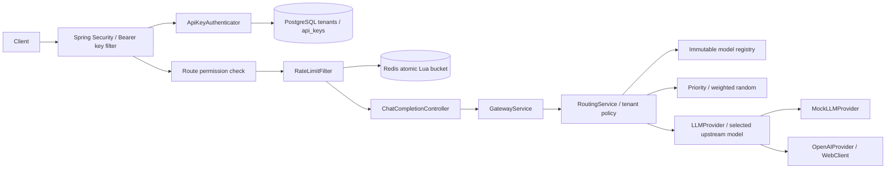

# Implemented architecture (Phases 1–6)

Java 21, Spring Boot MVC modular monolith. Capability packages own business rules and infrastructure. Redis-backed tenant rate limiting is implemented. Caching, Kafka, usage billing, OAuth, and circuit breakers remain unimplemented.

## Authentication and isolation

The immutable principal contains tenantId, keyId, and permissions. No raw key, digest, or provider credential is attached. Authorization uses CHAT_COMPLETIONS. Public health remains minimal; all other non-chat routes are denied. Context is request-local, cleaned in a finally block and by the security chain. There are no sessions or development authentication bypasses. A separate generated default user is disabled.

ApiKeyCrypto generates 256-bit secrets with SecureRandom and computes HMAC-SHA256 with a separate mandatory pepper. Mac instances are per operation, so concurrent requests do not share mutable digest state. Full-key digests bind the secret to its public identifier and use constant-time comparison. API key metadata excludes plaintext/digests. Authenticator-only public-id lookups join tenant status. Management queries scope by tenant UUID plus resource UUID; tenant headers are ignored. Every authentication rereads database state; revocation/suspension take effect for subsequent checks, not retroactive cancellation of requests already executing. Authentication database failures fail closed.

## Persistence and migration

Flyway V1 initializes tenants and api_keys on an empty PostgreSQL database. Entities use UUID primary keys, timestamps, string enums, and a tenant foreign key. Tenant name/slug and key public identifier are unique. Indexes cover tenant listings/status. Database checks cover statuses, metadata, digest formats, expiration and revocation consistency. Hibernate validates only; open-in-view and SQL/bind logging are disabled. No plaintext bearer key column exists. Losing/changing the pepper invalidates outstanding keys; recover it from the secret manager or reissue keys under a controlled rollout.

## Provisioning boundary

LocalAdminRunner exists only under local and not prod, requires explicit non-web mode and a command, and closes the context after execution. There are no administrator or tenant-registration HTTP endpoints. Creation returns the plaintext key once to the local tool, which writes a new owner-only file and prints metadata only. Keys and .env must remain untracked. Production has no default admin credential or bootstrap bypass; operator access to its database and provisioning is an infrastructure concern.

Rotation deliberately consists of separate issue, deploy/verify, and revoke steps. A replacement key is committed before the old one is revoked. No automatic transaction revokes the old key before clients have received/tested the replacement.

## Provider boundary and contracts

Public JSON payloads remain unchanged. GatewayService now uses RoutingService; the provider boundary accepts an explicit upstream model and retains built-in legacy entry points. The security filter runs before controller validation. Mock output is deterministic. OpenAI uses server-side credentials, fixed HTTPS destination, configured aliases/deadlines, one non-streaming POST, sanitized errors, and no retries or redirect following. Gateway keys are distinct from vendor keys. No live OpenAI request is made in automated tests.

## Verification and operations

Surefire runs unit tests; Failsafe runs HTTP and PostgreSQL tests against Testcontainers PostgreSQL 16 and Redis 7.4. Docker is required; integration tests do not silently skip when unavailable. Flyway runs on a fresh container and JPA validates the resulting schema. CI runs the full suite. Docker image construction runs unit tests only because a Docker build stage lacks a Testcontainers daemon; full verification must precede packaging on the host/CI. Compose supplies PostgreSQL and Redis and loopback-only ports. Production still requires TLS, protected secrets/database access, backups, and deployment hardening.

## Distributed rate limiting

The `ratelimit` capability owns validated `RateLimitProperties`, the Redis adapter `RedisTokenBucket`, and `RateLimitFilter`. The security configuration constructs the filter only inside Spring Security, after `AuthorizationFilter`; it is not auto-registered as a servlet filter. Authentication and route permissions must succeed before Redis consumption. Rate limiting remains separate from model routing and provider transport; it runs before MVC and routing.

The Redis hash `gateway:ratelimit:v1:{tenant UUID}:chat` shares one request bucket across keys and replicas for the principal's tenant. Lua loads tokens/timestamp, uses Redis TIME, refills with fractional precision, caps to capacity, conditionally deducts cost, and persists with a TTL no shorter than full refill. Backward server-clock steps retain the previous timestamp and extend TTL/retry estimates. The one-key contract works with Redis Cluster hash slots, although the supplied local configuration uses standalone Redis 7+. Arguments are capacity/refill-per-second/cost; result is allowed/whole-remaining/retry-seconds/full-refill-seconds. No application-clock input, local counters, or separate read/write race exists.

Defaults are capacity 60, refill 1 token/second, cost 1, FAIL_CLOSED. UUID-keyed tenant overrides are deployment configuration and must match across replicas. Failure returns 503 without provider invocation; explicit FAIL_OPEN bypasses enforcement without claiming headers. Denials return 429 Problem Details and Retry-After, while successful checks and denials expose X-RateLimit-Limit/Remaining/Reset (relative full-refill seconds). Charge is per authorized attempt before validation, with no refund or automatic retry. Redis state loss can reset allowances; AOF/noeviction reduces but does not eliminate that risk.

Tests include two real application contexts sharing PostgreSQL/Redis and concurrent HTTP traffic; exactly the configured burst succeeds. They also cover request cost, fractional refill, TTL, tenant/key sharing and isolation, invalid/unpermitted keys, provider non-invocation, configuration validation, and a stopped isolated Redis container under both outage policies. No real OpenAI requests occur. See README for operational settings and local curl examples.

## Model routing and tenant policy

The `routing` capability owns immutable `RoutingProperties`/`ModelRegistry`, `RoutingService`, `RoutingDecision`, and `RoutingStrategy` implementations. The former first-match ProviderSelector is removed. GatewayService requests one decision and invokes exactly that provider with the selected upstream model; its normalized public response always contains the requested alias. Adapters own vendor transport and credentials. Authentication/tenant persistence and the Redis limiter are unchanged.

Registry defaults preserve mock-chat and enabled legacy gateway.openai.models aliases; explicit routing models replace/add entries. Candidate configuration contains provider ID, upstream model ID, enabled status, nonnegative priority, and bounded positive integer weight. Startup rejects malformed/duplicate/unknown configuration, including invalid policy references and unrecognized routing property names. Missing conditional built-in adapters are known but unavailable; custom provider IDs require a registered adapter. Model validity is static adapter validation, not live health or vendor discovery.

Routing reads the tenant UUID and CHAT_COMPLETIONS permission from the authenticated SecurityContext principal. Policies explicitly allow aliases and providers; a tenant override replaces the default. Without explicit defaults, only legacy aliases and built-in providers remain allowed. New aliases require a grant, and empty allow-lists deny access. Unknown aliases return 400 unsupported_model; model/provider policy denial returns 403 model_forbidden; no enabled eligible candidate returns 503 provider_unavailable. Requests have already consumed rate allowance before routing errors.

PRIORITY sorts ascending priority, then provider ID and upstream model ID. WEIGHTED_RANDOM uses a uniform bounded integer from injectable RandomSource and cumulative positive weights over eligible candidates. It ignores priority and offers statistical proportions, not exact allocation or shared scheduling. Strategies receive only authorized eligible candidates and return one candidate. There is no health filtering, fallback, retry, circuit breaker, pricing discovery, or caching.

A RoutingDecision holds selected adapter/model/strategy/correlation ID as an internal servlet request attribute; no entity or credentials are serialized. Micrometer gateway.routing.decisions uses only provider and strategy labels. CorrelationIdFilter generates a server UUID in X-Request-ID and MDC before security, ignoring client IDs and restoring/clearing MDC in finally. Structured decision logs contain only correlation ID, configured provider/upstream model, and strategy. Production ECS logging renders SLF4J key-value fields. Tests cover scoped correlation cleanup, metric labels, priority ties, seeded weighted distribution, disabled candidates, tenant policies, sanitized HTTP errors, one attempt on provider failure, and explicit upstream model translation against a loopback OpenAI stub. Existing PostgreSQL/Redis suites continue to verify authentication, tenant lifecycle, and shared rate limits.
