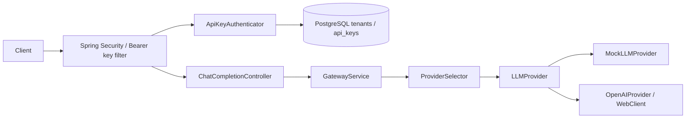

# Implemented architecture (Phases 1–4)

Java 21, Spring Boot MVC modular monolith. Capability packages own business rules and infrastructure. No Redis, rate limiting, caching, Kafka, usage billing, OAuth, or circuit breakers are implemented.

## Authentication and isolation

The immutable principal contains tenantId, keyId, and permissions. No raw key, digest, or provider credential is attached. Authorization uses CHAT_COMPLETIONS. Public health remains minimal; all other non-chat routes are denied. Context is request-local, cleaned in a finally block and by the security chain. There are no sessions or development authentication bypasses. A separate generated default user is disabled.

ApiKeyCrypto generates 256-bit secrets with SecureRandom and computes HMAC-SHA256 with a separate mandatory pepper. Mac instances are per operation, so concurrent requests do not share mutable digest state. Full-key digests bind the secret to its public identifier and use constant-time comparison. API key metadata excludes plaintext/digests. Authenticator-only public-id lookups join tenant status. Management queries scope by tenant UUID plus resource UUID; tenant headers are ignored. Every authentication rereads database state; revocation/suspension take effect for subsequent checks, not retroactive cancellation of requests already executing. Authentication database failures fail closed.

## Persistence and migration

Flyway V1 initializes tenants and api_keys on an empty PostgreSQL database. Entities use UUID primary keys, timestamps, string enums, and a tenant foreign key. Tenant name/slug and key public identifier are unique. Indexes cover tenant listings/status. Database checks cover statuses, metadata, digest formats, expiration and revocation consistency. Hibernate validates only; open-in-view and SQL/bind logging are disabled. No plaintext bearer key column exists. Losing/changing the pepper invalidates outstanding keys; recover it from the secret manager or reissue keys under a controlled rollout.

## Provisioning boundary

LocalAdminRunner exists only under local and not prod, requires explicit non-web mode and a command, and closes the context after execution. There are no administrator or tenant-registration HTTP endpoints. Creation returns the plaintext key once to the local tool, which writes a new owner-only file and prints metadata only. Keys and .env must remain untracked. Production has no default admin credential or bootstrap bypass; operator access to its database and provisioning is an infrastructure concern.

Rotation deliberately consists of separate issue, deploy/verify, and revoke steps. A replacement key is committed before the old one is revoked. No automatic transaction revokes the old key before clients have received/tested the replacement.

## Provider boundary and contracts

Controller/service/provider interface and JSON payloads remain unchanged. The security filter runs before controller validation. Mock output is deterministic. OpenAI uses server-side credentials, fixed HTTPS destination, configured aliases/deadlines, one non-streaming POST, sanitized errors, and no retries or redirect following. Gateway keys are distinct from vendor keys. No live OpenAI request is made in automated tests.

## Verification and operations

Surefire runs unit tests; Failsafe runs HTTP and PostgreSQL tests against Testcontainers PostgreSQL 16. Docker is required; integration tests do not silently skip when unavailable. Flyway runs on a fresh container and JPA validates the resulting schema. CI runs the full suite. Docker image construction runs unit tests only because a Docker build stage lacks a Testcontainers daemon; full verification must precede packaging on the host/CI. Compose supplies PostgreSQL and loopback-only ports. Production still requires TLS, protected secrets/database access, backups, and deployment hardening.
